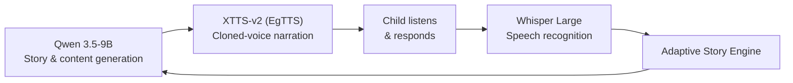

<h1 align="center">🐻 Smartino</h1>
<h3 align="center">Arabic Language Learning Through Games & Stories</h3>

<p align="center">
  A Flutter-based mobile app that turns learning Arabic into an interactive cultural adventure for young children, powered by a fine-tuned LLM, a cloned Egyptian-Arabic voice, and speech recognition.
</p>

<p align="center">
  
  
  
  
  
</p>

<p align="center"><i>Graduation Project · Egypt Japan University of Science & Technology (E-JUST) · 2026</i></p>

---

## 📖 Overview

Most Arabic learning apps for children suffer from low engagement: limited interactivity, little cultural integration, and no emotional connection with the learner. **Smartino** closes that gap by combining **gamification, adaptive storytelling, a friendly animated companion (Fartour 🐻), and AI voice technology** in a single child-friendly app.

Instead of treating language learning as a chore, Smartino lets children listen to stories, talk back to the app, play letter games and earn badges, all in Egyptian Arabic.

### The problem

| Existing app | Limitation |
|---|---|
| AlifBee | Structured, but lacks gamification |
| Dooling Kids | Good gamification, limited Arabic culture |
| Lamsa | Rich content, poor interactivity |
| Write It Arabic | Alphabet only, no storytelling |

---

## ✨ Key Features

- 🎮 **Gamification:** educational mini-games, achievement badges, and real-time leaderboards
- 📖 **Adaptive story engine:** stories personalized to the child's age, skill level, interests and cultural background
- 🎙️ **AI voice cloning:** warm, human Egyptian-Arabic narration instead of a robotic voice
- 🗣️ **Voice-driven interaction:** children answer by speaking; the app transcribes and validates their pronunciation
- 🐻 **Fartour, the character companion:** an animated friend that reacts emotionally to the child's progress
- 🔤 **Arabic letter recognition:** mini-games on letter identification, pronunciation and writing patterns
- 🎨 **Child-centered UI:** large touch targets, high contrast, minimal text, visual-first design
- 📱 **Cross-platform:** one Flutter codebase for iOS and Android

---

## 🧠 AI Pipeline

Smartino is powered by three models that work together in a closed loop:



| Model | Role | Details |
|---|---|---|
| **Qwen 3.5-9B** | Arabic text generation | Generates age-appropriate Egyptian-Arabic stories, vocabulary exercises and quiz questions. Fine-tuned with QLoRA + GRPO |
| **XTTS-v2 (EgTTS)** | Voice cloning and narration | Fine-tuned on a single speaker's Egyptian-Arabic voice to give Fartour a consistent, child-friendly voice |
| **Whisper Large** | Speech recognition | Transcribes the child's spoken Arabic to validate answers and give pronunciation feedback, fine-tuned on child Arabic audio |

### 🔬 Qwen 3.5-9B Fine-Tuning

**The problem we found:** the base model answered in Arabic but *reasoned internally in English*, and on harder questions English leaked into its output, which is unsuitable for a child-facing app.

**Our solution (3 phases):**

1. **Phase 0 – Initial SFT:** first run on `sft_full_v5` (2,574 samples), which revealed the English "thinking bleed-through".
2. **Phase 0.5 – Arabic Chain-of-Thought dataset:** generated Egyptian-Arabic `<think>` blocks for the samples using Ollama + Aya 8B locally, with a quality filter (84.6% success: 2,178 / 2,574 samples) → `sft_cot_v1`.
3. **Phase 1 + 2 – QLoRA SFT + GRPO:** re-trained on the CoT dataset with QLoRA, then applied GRPO reinforcement learning.

**QLoRA configuration**

| Setting | Value |
|---|---|
| Hardware | 1× RTX A5000 (24 GB) on RunPod |
| Quantization | 4-bit NF4 (BitsAndBytes), ~75% VRAM saved |
| LoRA | r=16, alpha=32, dropout=0.05, 0.31% of 9.4B parameters trainable |
| Optimizer | AdamW 8-bit |
| Sequence packing | 2048-token windows |
| Effective batch size | 16 (2 × 8 gradient accumulation) |
| Learning rate | 2e-4 (SFT), 5e-6 (GRPO) |
| Frameworks | Unsloth, TRL, PEFT |

**GRPO reward functions** (4 candidate answers generated per question and scored on each):

| Reward | Weight | What it checks |
|---|---|---|
| Arabic thinking quality | 30% | `<think>` block exists and is >60% Arabic |
| Egyptian dialect score | 30% | Egyptian markers (ايه، عشان، دلوقتي…) and Arabic character ratio |
| Semantic correctness | 25% | Cosine similarity to the reference using multilingual sentence embeddings |
| Age-appropriate length | 15% | KG: 10–60 words · Grade 3–4: 30–120 · Grade 5–6: 50–180 |

### 📊 Results (held-out test set, 142 samples)

| Metric | Before | After |
|---|---|---|
| Perplexity (lower is better) | 18.45 | **4.32** (−76.6%) |
| Token F1 | 2.35% | **26.97%** (+1,047%) |
| BLEU | 0.0 | **36.59** |
| BERTScore F1 | 0.40 | **0.7362** |
| Arabic thinking in outputs | 0% | **100%** |

All grade levels reached 100% Arabic thinking:

| Grade | Age | Token F1 | Samples |
|---|---|---|---|
| KG | 5–7 | 34.66% | 32 |
| Grade 3–4 | 8–10 | 22.51% | 57 |
| Grade 5–6 | 10–12 | 27.12% | 53 |

### 🔊 EgTTS (XTTS-v2) Voice Pipeline

1. **Voice collection:** single-speaker Egyptian-Arabic narration in a child-friendly reading style
2. **Clean and align:** background noise removal, transcript checking, removal of unstable clips
3. **Segmentation:** shorter narration chunks for consistent pace and long-story stability
4. **XTTS-v2 fine-tuning:** 100 epochs (Text CE loss 0.027, Mel loss 1.91, total loss 0.12)

> The training losses show stable convergence. Final voice quality should also be validated with listening tests (MOS, intelligibility, speaker similarity).

### 🧩 Adaptive Story Engine

| Input | Processing | Output |
|---|---|---|
| Child's age and skill level | AI selects story branches | Personalized story content |
| Vocabulary performance data | Adjusts vocabulary complexity | Dynamic audio narration |
| Preferred story themes | Chooses cultural references | Synchronized animations |
| Cultural background profile | Picks matching voice style | Targeted vocabulary practice |

To avoid over-correcting difficulty, the engine uses a moving-average score over the last 5 sessions, and a short onboarding mini-game solves the cold-start problem for new users.

---

## 📱 Mobile App

**Frontend:** Flutter (Dart), Riverpod for state management, AudioPlayers, Lottie / Rive animations, custom `TimelineController` for audio-visual sync and dynamic text highlighting

**Backend:** Firebase Authentication, Cloud Firestore, Firebase Cloud Storage, JSON-based story format, `GameManager` service for gamification logic

**Engineering challenges we solved**

| Challenge | Solution |
|---|---|
| Keeping Fartour's animations in sync with audio | Custom `TimelineController` binding animation frames to audio timestamps (<50 ms tolerance) |
| iOS vs Android differences (RTL text, fonts) | Flutter widget layer + manual RTL overrides + a device QA matrix |
| Managing story, user and game state together | Riverpod with isolated providers for each state |
| Race conditions on shared leaderboards | Firestore atomic transactions and debounced writes |

---

## 🧪 User Testing

We tested the app with children aged 4–6 in 30-minute sessions, with written feedback from parents and educators. We observed high engagement, improved Arabic letter identification and pronunciation, sustained attention, a positive emotional response to Fartour, and completion of all educational games and activities.

---

## 🛣️ Roadmap

- [ ] AI-powered personalization (in progress)
- [ ] Content library expansion (in progress)
- [ ] Parent & teacher dashboard (in progress)
- [ ] Offline mode
- [ ] Multi-dialect support

---

## 📸 Demo

<!-- Add screenshots or a demo GIF here -->
<!--  -->
<!-- [Watch the demo video](YOUR_VIDEO_LINK) -->

---

## 🚀 Getting Started

<!-- Fill this in with your real setup steps. Example: -->

```bash
git clone https://github.com/perlasami/smartino.git
cd smartino
flutter pub get
flutter run
```

---

## 👥 Team

- Shahd Ayman
- Nourhan Elhalawany
- **Perla Sami** (AI & NLP: Qwen fine-tuning, XTTS-v2, Whisper)
- Abdelrahman Wageh
- Fares Elaraby

---

## 📄 License

Add a license (e.g. MIT) or state that the project is for academic use.
